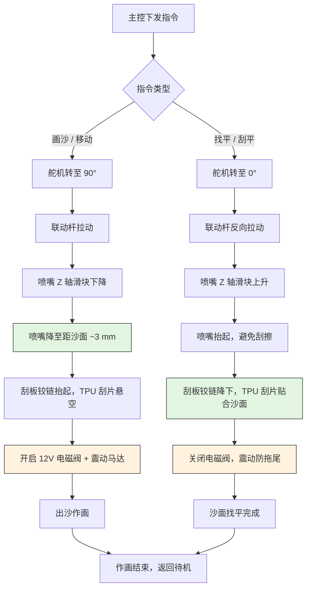
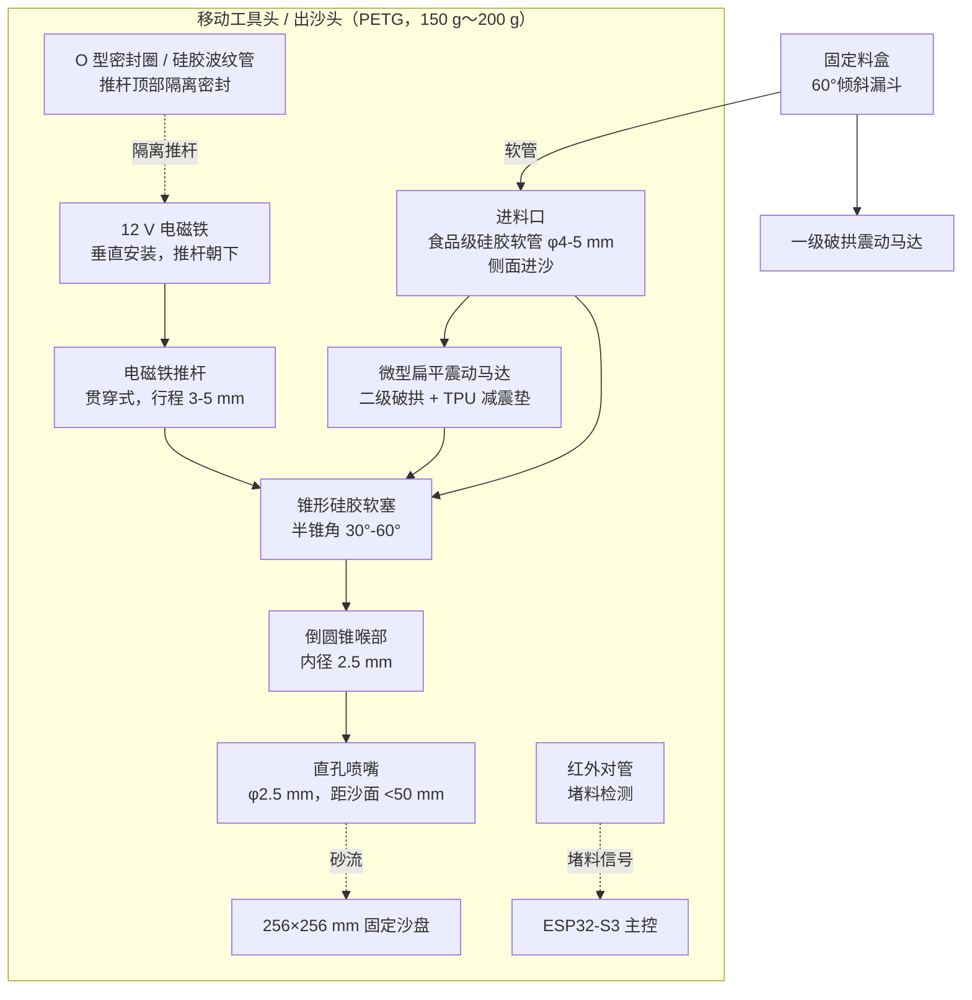

# Auto-Sand-Art-Robot 机械设计规格书

> 版本：v1.0（机械与硬件设计定稿）  
> 项目：嘉立创「星火计划」悬赏赛道 — Auto-Sand-Art-Robot  
> 结构形式：CoreXY 动龙门（Moving Gantry），无 Z 轴，256 × 256 mm 固定沙盘  
> 机架材料：2020 铝型材 + MGN12H 微型直线导轨 + 2GT 玻纤芯同步带  
> 维护者：RainCatStar @ SSIR_GDSYZX

---

## 0. 设计总纲

本规格书定义 Auto-Sand-Art-Robot 的机械整体架构与核心子系统技术要求。设计核心原则为 **“移动部件轻量化、固定部件承重、粉体密封可靠、防漏拖尾机械优先”**。全部打印件由 Bambu Lab A1 完成，结构电子分离，料仓、电源、主控固定于机架，移动端仅保留出沙阀、震动马达与喉管。

CoreXY 双电机固定于机架，X/Y 通过同步带传动，龙门横梁带动出沙头在固定沙盘上方平面往复。彻底取消传统 3D 打印机 Z 轴，沙盘固定不动，出沙高度由喷嘴至沙面固定间距保证（距沙面 < 50 mm）。

---

## 1. 整体运动架构

### 1.1 机架与运动平台
- 型材：2020 铝型材，构成封闭框架，有效画幅 256 mm × 256 mm。
- 导轨：MGN12H 微型直线导轨，X/Y 各两条，滑块与龙门横梁/滑板刚性连接。
- 传动：2GT-6 mm 玻纤芯同步带，20T 带轮，1/16 微步下理论分辨率约 0.025 mm，实际保守按 0.1 mm 设计。
- 步进电机：NEMA 17 42 步进 × 2（CoreXY 双电机），0.45 N·m，驱动 TMC2209（UART 模式），静音并支持传感器less 回零。
- 沙盘：256 × 256 mm，固定于机架底盘，不随龙门移动。

### 1.2 分离式供料哲学
料仓固定于龙门架最高处，通过柔性软管与移动工具头连接。移动端只带出沙阀、震动马达与喉管，总质量严格控制在 150 g～200 g，以最小化 CoreXY 往复惯性，保障精细轨迹与高速响应。

---

## 2. 供料与软管管理（固定端 → 移动端）

### 2.1 料盒（料仓，高位重力落料）
- 安装位置：固定于龙门架最高处，重心靠上，利用重力自流，无需额外加压。
- 漏斗底部：必须为 60° 倾斜漏斗形，防止沙粒在底部残留与桥接。
- 一级破拱：漏斗外侧安装微型震动马达，对漏斗壁施加高频激励，防止砂粒拱管与堵料。
- 出料口：顶部为侧向进料，由食品级硅胶软管引出，向下经大 U 型弧度连至移动端工具头。

### 2.2 传输软管（柔性进料与防缠绕管理）
- 规格：内径 4～5 mm 的光滑食品级硅胶管，内壁不粘细沙，耐屈挠疲劳。
- 布线方式：采用大“U 型”悬垂连接料盒与移动工具头，在 CoreXY 全行程往复中保持足够松量，避免拉紧导致步进失步或工具头受力偏移。
- 形变余量：由于喷嘴具备 Z 轴升降（见第 3 章单舵机联动机构），软管必须额外留出“大 U 型”下垂弧度，以吸收喷嘴升降时的垂直位移，避免软管对喷嘴产生硬拉扯。
- 张力管理：软管沿线配合轻质弹簧张紧器（`Tube_Tensioner`），对软管施加恒定轻牵引，防止软管拖地、缠绕或与导轨、横梁干涉，同时又不限制 Z 轴升降行程。
- 管路长度：控制在 600 mm 以内，减小压降与出沙延迟。
- 防静电：管路外缠接地铜箔，消除细沙摩擦产生的静电吸附与管壁挂料。

---

## 3. 单舵机联动机构（Z 轴微调与刮板互斥）

本机构是本项目的核心创新之一，**仅使用一个微型舵机**，通过摇臂/齿条联动，实现“喷嘴降下画沙时刮板抬起”与“刮板降下找平时喷嘴抬起”的互斥动作，彻底取消独立 Z 轴电机。

### 3.1 机械原理

- **执行器**：金属齿轮微型舵机（如 MG90S），固定于龙门横梁或工具头侧板，行程约 90°。
- **联动件**：舵机摇臂（`Servo_Linkage_Arm`）通过连杆与喷嘴 Z 轴滑块（`Nozzle_Slider`）和刮板铰链（`Squeegee_Hinge`）耦合。
- **互斥逻辑**：
  - 舵机转角 0°：喷嘴抬起（Z 轴上限），刮板降下，TPU 刮片贴合沙面，执行找平/刮平。
  - 舵机转角 90°：喷嘴降下（Z 轴下限，距沙面约 3 mm），刮板抬起悬空，开启阀门出沙作画。
- **Z 轴自由度**：喷嘴通过 `Nozzle_Slider` 在工具头主体内导向上下滑动，行程 3～5 mm，画沙时降至工作位，非作画时抬起避免刮擦沙面。
- **防背隙与限位**：
  - 3D 打印齿轮存在背隙，在联动件与滑块之间预留拉簧，持续施加轻微预紧力，消除齿轮回程空程。
  - 在滑块导轨两端设置物理限位挡块，确保喷嘴最低点严格限制在距沙面约 3 mm，防止喷嘴压坏沙面或陷入砂层；最高处限制刮板不碰撞横梁。
  - 物理限位取代软件限位作为最后一道安全保护，即使舵机失控，喷嘴也不会撞击沙盘。

### 3.2 舵机逻辑流程图

### 3.3 关键尺寸

| 参数 | 数值 | 说明 |
|------|------|------|
| 舵机型号 | MG90S 金属齿轮 | 扭矩足够，齿轮耐磨 |
| 联动行程 | 90° | 对应 Z 轴升降 3～5 mm |
| 喷嘴最低限位 | 距沙面 ~3 mm | 物理挡块硬限位 |
| 消隙拉簧 | 0.1～0.3 N 预紧 | 消除 3D 打印齿轮背隙 |
| 刮片材质 | TPU 柔性 | 不刮伤沙盘，不卡砂粒 |

---

## 4. 核心工具头设计（锥形阀与隔离密封）

工具头整体采用 PETG 打印，总重控制在 150 g～200 g。结构自上而下分三个功能区。

### 3.1 进料与流化区
- 软管从侧面进入，外壳侧面贴微型扁平震动马达，配合 TPU 减震垫，负责二级破拱与砂粒流化，防止进料口与阀腔顶部结块。
- 震动马达与电磁铁时序协同（见第 4 章）。

### 3.2 截流控制区（锥形阀，基于用户草图）
该区为工具头核心，设计要点如下：

1. **侧面进沙**：砂流从侧面进入阀腔，避免砂粒重力直接压迫阀芯，导致电磁铁吸合力不足无法拉开阀门。
2. **电磁铁安装**：12 V 推拉式电磁铁垂直安装，推杆朝下，末端连接锥形硅胶软塞；推杆为贯穿式，行程 3～5 mm。
3. **锥形阀结构**：硅胶软塞半锥角 30°～60°，与底部对应的 2.5 mm 内径倒圆锥喉部精密配合。断电时弹簧将硅胶塞压紧喉部，实现机械自锁、零漏沙；通电吸合时推杆下移拉开硅胶塞，砂流通过倒圆锥喉部。
4. **隔离密封（关键）**：电磁铁推杆穿入阀腔的顶部必须加装 O 型密封圈或硅胶波纹管，绝对防止细沙粒沿推杆进入电磁铁线圈与机械传动部件，导致卡塞或短路。

### 3.3 落沙与检测区
- 喷嘴：极短的 2.5 mm 直孔喷嘴，喷嘴出口距沙面 < 50 mm，保证落沙点定位精度与砂流聚焦。
- 堵料检测：喷嘴旁侧安装红外对管（IR Slot Sensor），砂流被堵塞或无砂流时输出跳变，供主控执行堵料保护。

### 3.4 工具头系统层级图

---

## 5. 震动协同流化（破拱 + 防拖尾）

震动分两级协同，分别作用于固定端料盒与移动端工具头：

- **一级破拱（料盒端）**：漏斗外侧震动马达对 60° 漏斗壁施加激励，防止砂粒拱管、桥接，保证恒定进料。
- **二级破拱（工具头端）**：外壳侧面微型扁平震动马达（配合 TPU 减震垫）对阀腔顶部与进料口流化，防止结块。

**关阀防拖尾时序**：
1. 关阀前约 100 ms，扁平震动马达满功率启动，震散喉部卡沙，使砂粒短暂流化；
2. 随后电磁铁断电，弹簧将锥形硅胶塞压紧倒圆锥喉部，机械闭锁；
3. 震动与电磁铁闭锁近乎同步，彻底切断砂流，不留拖尾。

100 ms 为初始值，后续须通过高速摄像或称重实测，锁定“震动足以散沙、不扰动已落沙”的最佳时窗。

---

## 6. 单舵机联动刮板机构（沙面平整）

刮板不再独立配舵机，而是与喷嘴 Z 轴共享**同一个 MG90S 金属齿轮舵机**，通过 `Squeegee_Hinge` 铰链与舵机联动杆耦合，实现互斥动作：

- **画沙时**：舵机转至 90°，联动杆拉动喷嘴下降至工作位，同时刮板铰链抬起，TPU 柔性刮片悬空，不接触沙面，避免干扰绘制。
- **找平/刮平时**：舵机转至 0°，联动杆拉动喷嘴抬起，同时刮板降下，TPU 柔性刮片贴合沙面，刮平凸起与填充凹陷，恢复沙面平整。
- **互斥保障**：喷嘴与刮板不可能同时接触沙面，物理结构天然防碰撞，无需额外 Z 轴电机。
- **挂载方式**：挂载于龙门横梁后方，与出沙头通过联动杆松耦合，避免影响画沙精度。

TPU 刮片具有一定柔顺度，既能平整沙面，又不会刮伤沙盘或卡住砂粒。

---

## 6. 与电气/固件接口（简要）

机械设计与 `hardware/` 及 `software/` 配合：
- 电磁铁：12 V，NMOS 低边驱动，ESP32-S3 PWM 控制（硬件 README 与 pinout.md 规定 GPIO）。
- 震动马达：3 V～5 V，ESP32-S3 PWM 调速。
- MG90S 金属齿轮舵机：ESP32-S3 PWM/GPIO 控制 Z 轴升降与刮板互斥动作（替代原独立 SG90）。
- 红外对管：≥ 2 个 GPIO 用于堵料检测（pinout.md GPIO 18 等）。

电气原理图、PCB 与引脚分配详见 `hardware/README.md`、`hardware/pinout.md` 及 `docs/CIRCUIT_DESIGN.md`。

---

> 以上为机械设计定稿，关键尺寸（2.5 mm 喉径、30°～60° 锥角、60° 漏斗、150～200 g 工具头质量）已写入 Fusion 360 顶层参数表，修改参数即可全局联动。详见 `models/README.md`。